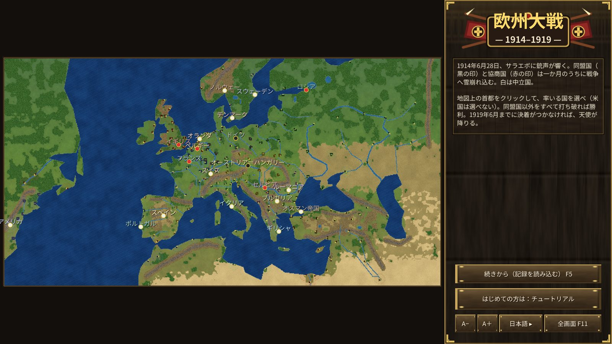
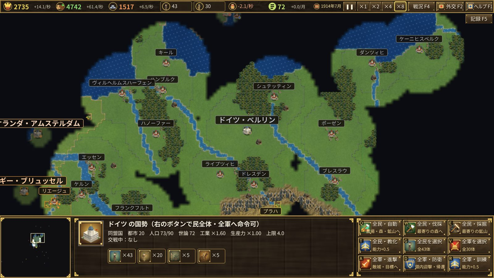
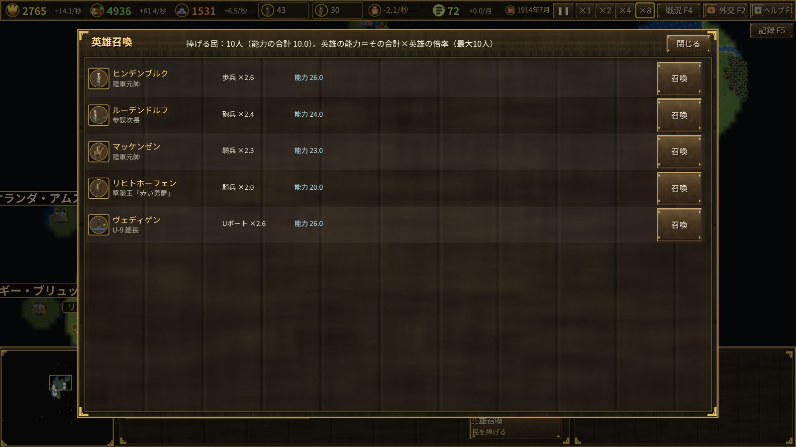

# The Great War 1914–1919 — Introduction

June 28, 1914: shots ring out in Sarajevo. Within a month the Central Powers (Germany, Austria-Hungary) and the Entente (Britain, France, Russia) tumble into war.
Choose one of 19 states (anyone but the United States) and lead it through five years of war.

## Goal

Defeat every state outside your alliance that is at war with you.
If no victor emerges by June 28, 1919 (the day of the Treaty of Versailles), angels descend from the skies of Europe, take every city within half a year, and the game ends.

## Highlights

- **A historical outbreak**: from Sarajevo to the July Crisis declarations, the war starts automatically on its historical dates. The Ottoman Empire, Italy, Bulgaria, Romania, Greece and Portugal also enter on theirs.
- **Historical cities**: about 200 real cities exist from the start, and no new ones can be founded. The war is fought over them.
- **Soldiers come from workers**: every soldier trained at a barracks takes a worker, so a bigger army means a thinner economy. Production and resources are richest at the outbreak and decline the longer the war lasts.
- **Public opinion and revolution**: heavier losses than the enemy, crushing military spending or empty granaries lower opinion. In an empire, opinion running out means revolution and surrender.
- **National units**: tanks (Britain, France, the US), stormtroopers (Germany), mountain troops (Italy, Austria-Hungary), U-boats (Germany, Austria-Hungary), destroyers (Britain, France, Italy, Russia, the US).
- **The sea and the colonies**: ships bring resources and workers to Britain and France from their colonies and from America; U-boats sink them. America stays neutral unless provoked.
- **Heroes**: you can call only heroes from your own state (Hindenburg, Foch, Brusilov, Kemal, Lawrence…).

See the [User Guide](user-guide.md) for how to play.
