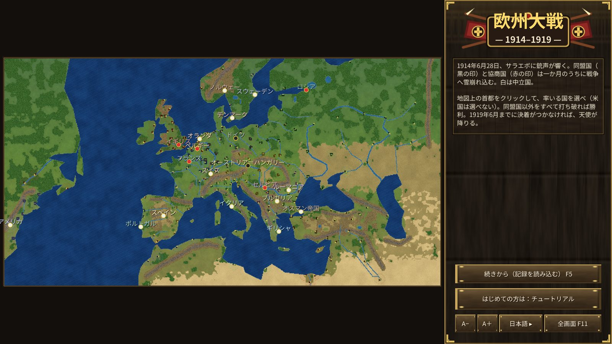
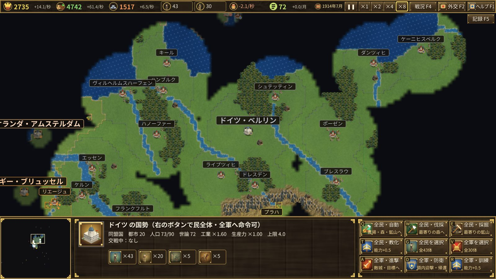
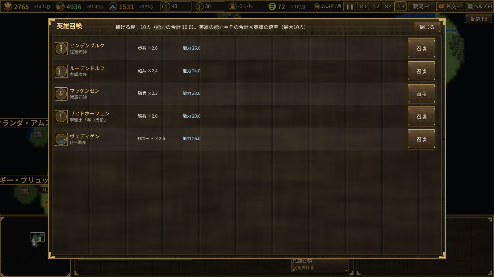

# 欧州大戦 1914–1919 — 紹介

1914年6月28日、サラエボに銃声が響く。一か月のうちに、同盟国（ドイツ・オーストリア＝ハンガリー）と協商国（イギリス・フランス・ロシア）は戦争へ雪崩れ込む。
あなたは米国を除く19か国から一国を選び、5年の大戦を指揮します。

## 目的

同盟国以外の国（あなたと戦っている敵国）をすべて打ち破れば勝利です。
1919年6月28日（ヴェルサイユ条約の日）までに勝者が現れなければ、天使が欧州の空から降り、半年のうちにすべての都市を占領してゲームは終わります。

## 見どころ

- **史実どおりの開戦**：サラエボ事件から七月危機の宣戦布告までは史実の日付に自動で起こる。オスマン帝国・イタリア・ブルガリア・ルーマニア・ギリシャ・ポルトガルも史実の日付に参戦する。
- **史実の都市**：約200の都市が最初からあり、新しい都市は築けない。都市を奪い合う戦争。
- **兵は民から**：兵営で兵を1人育てるたびに民が1人減る。軍を大きくすれば経済は細る。生産力も資源も開戦時がもっとも豊かで、戦争が長引くほど減っていく。
- **世論と革命**：損害が敵より多い、軍事費が重い、食糧が尽きた……が続くと世論が下がる。帝政の国では世論が尽きると革命が起きて降伏する。
- **国ごとの兵種**：戦車（英仏米）、突撃兵（ドイツ）、山岳兵（イタリア・オーストリア）、Uボート（ドイツ・オーストリア）、駆逐艦（英仏伊露米）。
- **海と植民地**：英仏には植民地と米国から船で資源と民が届く。Uボートはこれを沈める。米国は妨害を受けない限り参戦しない。
- **英雄召喚**：自国出身の英雄（ヒンデンブルク・フォッシュ・ブルシーロフ・ケマル・ロレンス……）だけを呼べる。

詳しい遊び方は [ユーザーガイド](user-guide.md) を参照してください。
