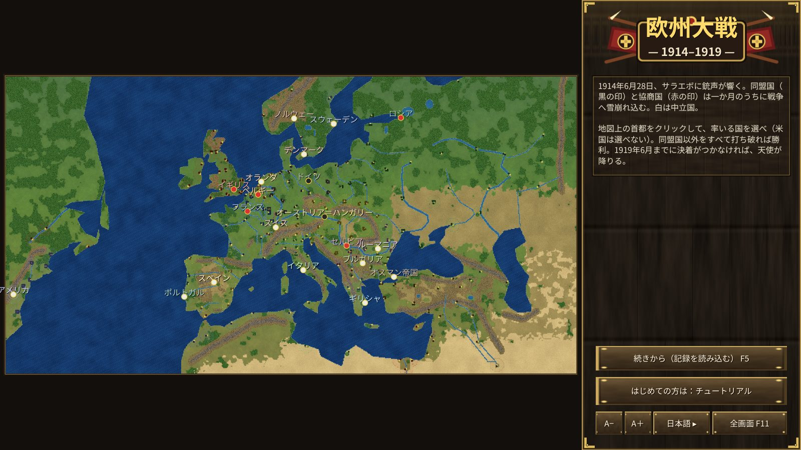
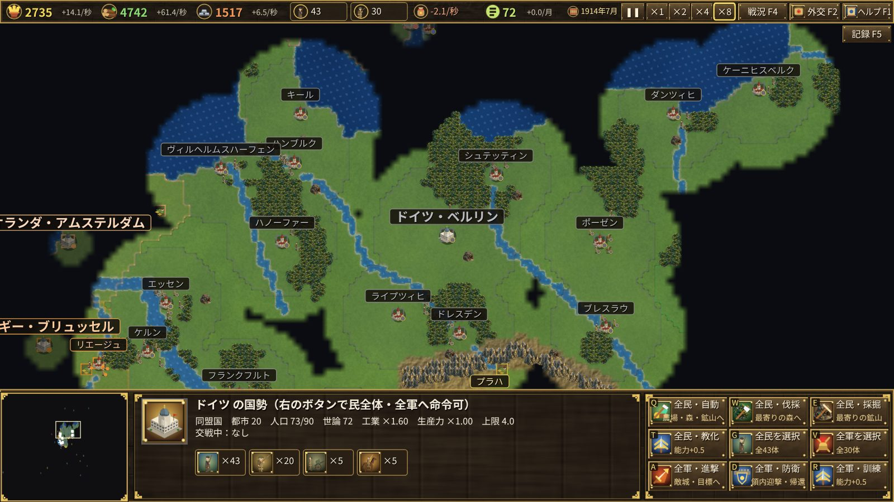

# 欧洲大战 1914–1919 — 介绍

1914年6月28日，萨拉热窝响起枪声。一个月之内，同盟国（德国、奥匈帝国）与协约国（英国、法国、俄国）卷入战争。
从美国以外的19个国家中选择一国，指挥长达五年的大战。

## 目标

击败同盟以外的所有国家（与你交战的敌国）即获胜。
若1919年6月28日（凡尔赛条约签订之日）前仍无胜者，天使将从欧洲上空降临，在半年内占领所有城市，游戏结束。

## 特色

- **史实的开战**：从萨拉热窝事件到七月危机的宣战，都会在史实日期自动发生。奥斯曼帝国、意大利、保加利亚、罗马尼亚、希腊、葡萄牙也会在史实日期参战。
- **史实城市**：约200座真实城市一开始就存在，无法新建。这是一场争夺城市的战争。
- **兵由民征召**：在兵营每训练一名士兵就会减少一名民。军队越大，经济越单薄。生产力与资源在开战时最为充足，战争越久越少。
- **舆论与革命**：损失多于敌方、军费沉重、粮食耗尽……舆论就会下降。帝制国家的舆论耗尽时会爆发革命而投降。
- **各国特有兵种**：坦克（英法美）、突击兵（德国）、山地兵（意大利、奥匈）、U艇（德国、奥匈）、驱逐舰（英法意俄美）。
- **海洋与殖民地**：英法从殖民地与美国经海路获得资源与民，U艇会将其击沉。美国除非受到妨碍，否则不会参战。

详细玩法请参阅[用户指南](user-guide.md)。
